  <a href="https://kevindemara.com/">Website</a> &nbsp; · &nbsp;
  <a href="https://kevindemara.com/work/">Portfolio</a> &nbsp; · &nbsp;
  <a href="https://www.linkedin.com/in/kevindemara/">LinkedIn</a> &nbsp; · &nbsp;
  <a href="mailto:hello@kevindemara.com">Say hello</a>

I'm Kevin. I work where **development, automation, and business overlap** — connecting models, information, and tools into software people can use. My background spans web development, e-commerce, and digital marketing.

## Selected builds

<table>
<tr>
<td width="50%" valign="top">

<h3><a href="https://github.com/kevindemara/local-ai-studio">Local AI Studio</a></h3>

A local AI workspace for building connected projects with Ollama models, MCP tools, checks, and previews.

JavaScript · Ollama · MCP

<a href="https://github.com/kevindemara/local-ai-studio">Explore the source →</a> &nbsp; Preview

</td>
<td width="50%" valign="top">

<h3><a href="https://github.com/kevindemara/PDFrig">PDFrig</a></h3>

A local-first PDF editor for editing supported text, organising pages, annotations, forms, and OCR.

TypeScript · Browser + Windows

<a href="https://github.com/kevindemara/PDFrig">Explore the source →</a> &nbsp; Public alpha

</td>
</tr>
<tr>
<td width="50%" valign="top">

<h3><a href="https://github.com/kevindemara/Porchlight">Porchlight</a></h3>

A Blink camera companion with a local recording archive, optional local AI, and owner-reviewed face matches.

Python · Windows · Local AI

<a href="https://github.com/kevindemara/Porchlight">Explore the source →</a> &nbsp; Development preview

</td>
<td width="50%" valign="top">

<h3><a href="https://github.com/kevindemara/hand-racer-velocity">Velocity</a></h3>

A 3D arcade racer with webcam hand steering, keyboard and controller input, and online multiplayer.

JavaScript · Three.js · MediaPipe

<a href="https://github.com/kevindemara/hand-racer-velocity">Explore the source →</a> &nbsp; Browser game

</td>
</tr>
</table>

## What I bring to a project

- **AI & automation:** connect models, data, and tools into useful workflows, with validation and human review.
- **Software & the web:** custom tools, desktop applications, websites, and e-commerce experiences.
- **Business context:** understand the problem, connect the pieces, and build around what matters.

